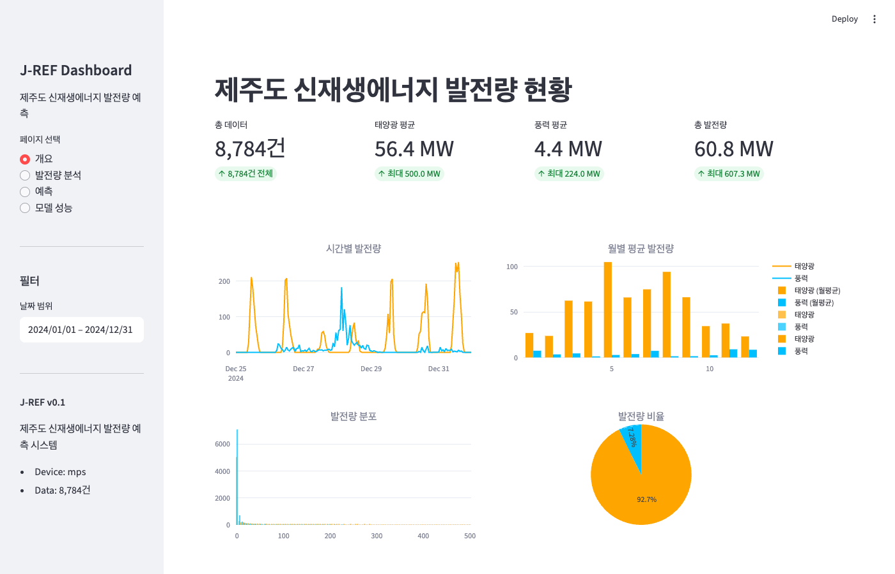

# Jeju Renewable Energy Demand Forecast (J-REF)

[](https://www.python.org/)
[](https://lightgbm.readthedocs.io/)
[](LICENSE)

> ⚠️ **Live Demo / API Docs: 현재 접속 불가** (2026-11 확인 — Streamlit 앱은 로그인 페이지로 리다이렉트, Render API는 404)
> 기존 주소: [Streamlit](https://kiminbean-kpx-demand-forecast.streamlit.app) | [API Docs](https://jref-api.onrender.com/docs)

## Project Overview

제주도의 **태양광 및 풍력 발전량**을 LightGBM(그래디언트 부스팅) 기반으로 예측하는 시스템입니다.
API 모델은 **관측 기상**(ASOS) 또는 사용자가 넣은 예보 기상을 발전량으로 매핑합니다 (태양광 V2는 직전 1시간 기상도 사용).
수치예보(JMA MSM)를 입력한 하루 전 조건 평가는 [docs/solar_evaluation_criteria.md](docs/solar_evaluation_criteria.md) §7에 있습니다 (태양광 FER 8.65%).

### 📸 Dashboard Preview



**주요 기능:**
- 실시간 발전량 현황 모니터링
- 시간별/월별 발전량 추이 시각화
- 태양광/풍력 발전량 비율 분석
- AI 기반 발전량 예측

기존의 통계적 기법이나 단순 시각화 서비스를 넘어, **제주도의 국지적 기상 특성(Micro-climate)을 반영한 고성능 예측 모델**을 구축하는 것을 목표로 합니다.

> **Target:** 시각화는 [햇빛바람지도](https://map.60hz.io/page/map)를 지향하되, 예측 성능(Accuracy)은 이를 초월합니다.

---

## Architecture Philosophy

**Clean Architecture** 원칙을 준수하여 유지보수성과 확장성을 확보합니다.

```
┌─────────────────────────────────────────────────────────────────┐
│                        Presentation Layer                        │
│                   (Streamlit Dashboard, API)                     │
├─────────────────────────────────────────────────────────────────┤
│                        Application Layer                         │
│              (Training, Inference, Visualization)                │
├─────────────────────────────────────────────────────────────────┤
│                         Domain Layer                             │
│           (Solar-Net, Wind-Net, Ensemble Models)                 │
├─────────────────────────────────────────────────────────────────┤
│                      Infrastructure Layer                        │
│            (Data Loaders, API Clients, File I/O)                 │
└─────────────────────────────────────────────────────────────────┘
```

### Key Principles

- **Modularity:** 데이터 전처리, 모델 학습, 추론 로직이 완벽히 분리
- **Strict Typing:** Python Type Hint를 적극 사용하여 코드 안정성 확보
- **Hybrid Modeling:** 태양광(Solar)과 풍력(Wind)의 물리적 특성 차이를 고려하여 별도의 모델을 학습 (앙상블은 초기 딥러닝 실험 코드 `src/models/ensemble.py`에만 있고 LightGBM/API 경로에서는 쓰지 않음)

---

## Directory Structure

```
kpx-demand-forecast/
├── .github/                   # CI/CD workflows
├── data/                      # 데이터 저장소 (Git ignore)
│   ├── raw/                   # 원천 데이터 (KPX, 기상청)
│   ├── processed/             # 전처리 완료 데이터
│   └── external/              # 외부 데이터 (휴일 정보 등)
├── docs/                      # 프로젝트 문서
│   └── PRD.md                 # 제품 요구사항 정의서
├── models/                    # 학습된 모델 체크포인트
├── notebooks/                 # EDA 및 프로토타이핑
├── src/                       # 핵심 소스 코드
│   ├── config.py              # 환경 설정
│   ├── data/                  # 데이터 로더
│   │   ├── weather_fetcher.py # 기상청 API 연동
│   │   └── kpx_loader.py      # KPX 데이터 로더
│   ├── features/              # Feature Engineering
│   ├── evaluation/            # KPX 예측오차율(FER) 지표
│   ├── models/                # 모델 아키텍처
│   │   ├── solar_v2.py        # 태양광 V2 (LightGBM, 운영)
│   │   ├── solar_lstm.py      # 태양광 Bi-LSTM (초기 실험)
│   │   ├── wind_transformer.py# 풍력 Transformer (초기 실험)
│   │   └── ensemble.py        # 앙상블 (초기 실험)
│   ├── training/              # 학습 루프
│   └── visualization/         # 시각화 유틸리티
├── api/                       # FastAPI 서버 (v1.2.0)
├── streamlit_app.py           # 대시보드 (KPX 실측 데이터)
├── tests/                     # 테스트 코드
├── .gitignore
├── requirements.txt
└── README.md
```

---

## Model Architecture

> **현재 상태:** 아래 Dual-Stream 구조는 초기 설계안입니다. 운영 모델은 태양광·풍력 모두 **LightGBM**입니다.
> Bi-LSTM·Transformer Encoder는 합성 데이터 초기 실험(R² 0.36 / −0.17)에만 쓰였고, Temporal Fusion Transformer는 구현되지 않았습니다.
> 앙상블 층은 초기 실험 코드 `src/models/ensemble.py`(SolarLSTM·WindTransformer 출력의 가중 평균 / 메타 러너)로만 있으며 LightGBM/API 경로에서는 쓰지 않습니다. 그래디언트 부스팅 앙상블은 구현되지 않았습니다 (Phase 4/6 스크립트의 LightGBM+XGBoost 가중 평균은 일회성 실험으로, 저장·서빙되지 않음).

### Dual-Stream Ensemble

태양광과 풍력은 물리적 특성이 완전히 다르므로, 각각 특화된 모델을 개발합니다.

```
                    Weather Features
                          │
          ┌───────────────┴───────────────┐
          │                               │
          ▼                               ▼
    ┌───────────┐                   ┌───────────┐
    │ Solar-Net │                   │ Wind-Net  │
    │  (LSTM)   │                   │ (Transf.) │
    └─────┬─────┘                   └─────┬─────┘
          │                               │
          └───────────┬───────────────────┘
                      │
                      ▼
               ┌─────────────┐
               │  Ensemble   │
               │   Layer     │
               └──────┬──────┘
                      │
                      ▼
              Final Prediction (MW)
```

| Model | Target | Architecture | Input Sequence |
|-------|--------|--------------|----------------|
| Solar-Net | 태양광 | Bi-LSTM + Attention (초기 실험) | 24h |
| Wind-Net | 풍력 | Transformer Encoder (초기 실험, TFT 미구현) | 48h |
| Ensemble | 통합 | 가중 평균 / 메타 러너 (초기 실험 코드, 미사용) — 그래디언트 부스팅 앙상블 없음 | Model Outputs |

---

## 🚀 Quick Start

```bash
# 1. 저장소 클론
git clone https://github.com/kiminbean/kpx-demand-forecast.git
cd kpx-demand-forecast

# 2. 가상환경 생성 및 활성화
python -m venv venv
source venv/bin/activate  # macOS/Linux
# .\venv\Scripts\activate  # Windows

# 3. 의존성 설치
pip install -r requirements.txt -r requirements_api.txt   # lightgbm은 requirements_api.txt에만 있음

# 4. 환경변수 설정 (.env 파일 생성)
echo "KMA_API_KEY=your_api_key_here" > .env

# 5. 대시보드 실행 (KPX 실측 데이터)
streamlit run streamlit_app.py
```

---

## Getting Started

### Prerequisites

- Python 3.10+
- GPU 불필요 (운영 모델은 LightGBM). Apple Silicon(MPS)·CUDA는 초기 딥러닝 실험에만 필요
- 기상청 공공데이터포털 API 키 ([data.go.kr](https://www.data.go.kr/))

### Installation

1. **Clone Repository**
   ```bash
   git clone https://github.com/kiminbean/kpx-demand-forecast.git
   cd kpx-demand-forecast
   ```

2. **Create Virtual Environment**
   ```bash
   python -m venv venv
   source venv/bin/activate  # macOS/Linux
   # or
   .\venv\Scripts\activate   # Windows
   ```

3. **Install Dependencies**
   ```bash
   pip install -r requirements.txt -r requirements_api.txt
   ```

4. **Setup Environment Variables**
   ```bash
   # .env 파일 생성
   cp .env.example .env
   # KMA_API_KEY 값을 본인의 API 키로 수정
   ```

5. **Download Data**
   ```bash
   # 기상청 ASOS 데이터 수집 (2024년)
   python scripts/download_data.py --year 2024
   ```

---

## Usage

### 1. 데이터 수집

```bash
# 기상청 ASOS 시간 데이터 수집
python scripts/download_data.py --year 2024

# 5년치 기상 패턴 데이터 수집 (2020-2024)
python scripts/collect_5year_data.py

# JMA MSM 과거 예보 (Open-Meteo, 하루 전 조건 평가용) → data/external/nwp/ (git 제외)
python scripts/download_nwp_openmeteo.py
```

### 2. 모델 학습

```bash
# 태양광 V2 (LightGBM): 모델 선택은 CV로
python scripts/train_solar_v2.py --cv
# 테스트 평가 + 저장: models/solar_v2/<variant>를 덮어씀 (API는 island_mean을 읽음).
# 2024-11-07~12-31 테스트 구간은 이미 사용했으므로 추가 모델 선택에 쓰지 말 것 (CV 또는 2025년 hold-out 사용)
python scripts/train_solar_v2.py --variant island_mean --evaluate-test

# 하루 전 조건 CV(48시간 전 예보, 모델 저장 없음). 테스트 수치 재현은 --evaluate-test → models/solar_v2_nwp/<variant>_nwp_msm_day2 (docs/solar_evaluation_criteria.md §7)
python scripts/train_solar_v2.py --weather nwp_msm_day2 --cv

# 테스트 (torch 미설치 환경이라 test_models.py 제외)
.venv/bin/python -m pytest tests/ -q --ignore=tests/test_models.py

# 초기 딥러닝 실험 (Bi-LSTM / Transformer, PyTorch 필요 — 운영 모델 아님)
python scripts/train.py --model solar --epochs 100
python scripts/train.py --model wind --epochs 100
```

### 3. 예측

```bash
# 단일 날짜 예측
python scripts/predict.py --model solar --date 2024-12-17

# 배치 예측
python scripts/predict.py --model wind --start 2024-12-17 --end 2024-12-24
```

### 4. API 서버

**배포된 API:** https://jref-api.onrender.com (⚠️ 현재 접속 불가 — 2026-11 확인 시 404. 아래 예시는 로컬 서버 기준)

```bash
# 로컬 서버 실행
uvicorn api.main:app --reload --host 0.0.0.0 --port 8000

# API 문서: http://localhost:8000/docs
```

**API 엔드포인트 예시:**
```bash
# 헬스체크
curl "http://localhost:8000/health"

# 모델 정보 조회
curl "http://localhost:8000/models"

# 발전량 예측 (POST, API v1.2.0)
# solar_radiation 단위는 MJ/m² (직전 1시간 누적, ASOS 시간 일사). W/m² 평균이면 × 0.0036
# history: 태양광은 직전 1시간 기상이 필수 (풍력 지연·이동평균에는 24시간 권장)
# 낮 시간 태양광은 solar_radiation과 cloud_cover(0~10)가 모두 필요 (없으면 400)
curl -X POST "http://localhost:8000/predict" \
  -H "Content-Type: application/json" \
  -d '{
    "weather": {
      "datetime": "2024-05-15T13:00:00",
      "temperature": 20.0, "humidity": 60.0, "wind_speed": 8.5,
      "wind_direction": 270.0, "pressure": 1013.0, "solar_radiation": 2.5, "cloud_cover": 3
    },
    "history": [
      {
        "datetime": "2024-05-15T12:00:00",
        "temperature": 19.5, "humidity": 62.0, "wind_speed": 8.0,
        "wind_direction": 270.0, "pressure": 1013.0, "solar_radiation": 2.4, "cloud_cover": 3
      }
    ],
    "energy_type": "both"
  }'
```

> **예측 구간 의미**: 시각 T의 태양광 예측은 KPX 발전량 구간 (T−1h, T] (거래시간 h = T의 시), 풍력 예측은 (T, T+1h] 입니다. 두 구간이 다르므로 `total_mw`는 `energy_type: both`에서도 `null`입니다.
> `/predict/batch`도 같은 형식입니다: `weather_data`에 연속된 시간별 기상 목록, `history`에 첫 시점 직전 1시간 이상.
> 모델이 로드되지 않으면 0 MW 대신 500을 돌려줍니다. 시간대가 있는 입력은 KST로 변환합니다.
> 응답의 상·하한은 정규 오차를 가정한 ±1.28·RMSE이며 보정된 80% 예측구간이 아닙니다. 태양광은 관측 기상 테스트 잔차의 낮/밤 RMSE(15.65 / 0.58 MW → ±20.0 / ±0.74 MW), 풍력은 Phase 5 테스트 RMSE 14.96 MW(±19.1 MW)를 씁니다.

### 5. 대시보드

```bash
# Streamlit 대시보드 실행 (KPX 실측 데이터, 출처 표시)
streamlit run streamlit_app.py
# 로컬은 data/processed/kpx_real_merged.csv, 클라우드는 data/sample/sample_data.csv(2024년 실측 전체)를 읽음
# dashboard/app.py는 합성 데이터를 쓰는 초기 대시보드

# 브라우저에서 http://localhost:8501 접속
```

---

## Data Sources

| Source | Data | URL |
|--------|------|-----|
| 기상청 | ASOS 시간 관측 데이터 (학습·API 입력) | [data.kma.go.kr](https://data.kma.go.kr/) |
| Open-Meteo | JMA MSM 과거 예보 (하루 전 조건 평가 전용, CC BY 4.0) | [open-meteo.com](https://open-meteo.com/) |
| KPX | 지역별 시간별 태양광·풍력 발전량 (전력거래량, 2024년) | [data.go.kr 15065269](https://www.data.go.kr/data/15065269/fileData.do) |

- KPX 공개 데이터는 **전력시장 거래량**입니다 (한전 PPA·자가용 제외, ESS 충방전 포함). 2024-06-01 제주 입찰제도 시범 이후 시장 태양광의 약 80%, 풍력의 18~35%만 포함합니다.
- 거래시간 h는 (h−1)~h시 발전량입니다. 시각 규약과 1시간 어긋남 주의사항: [docs/DATA_COLLECTION_GUIDE.md](docs/DATA_COLLECTION_GUIDE.md)

---

## 📊 Model Performance

### 평가 지표

- 태양광·풍력 발전량은 **KPX 예측오차율(FER)** = |예측 − 실측| ÷ 설비용량 × 100 으로 평가합니다 (실측 ≥ 설비용량 10%인 시간만). 수요 예측은 MAPE를 씁니다.
- 발전량 MAPE는 실측이 0에 가까운 시간에 폭주하므로 쓰지 않습니다. 상세: [docs/solar_evaluation_criteria.md](docs/solar_evaluation_criteria.md)
- 아래 수치는 관측 기상을 입력한 결과라서 하루 전 예측 성능의 **상한**입니다. 하루 전 조건은 아래 "Solar V2 하루 전 조건" 참조.

### Solar V2 (2026-11-06, 테스트 2024-11-07 ~ 12-31, 분모 359.4 MW)

| Model | FER | MAE | R² |
|-------|-----|-----|-----|
| 기존 Solar (LightGBM `real_baseline`) | 6.93% | 9.70 MW | 0.913 |
| **Solar V2 (`stations_level`)** — 연구 최고, 발전량 이력(D-2 발전 수준) 필요 | **4.16%** | **5.16 MW** | 0.967 |
| Solar V2 (`island_mean`) — **API 서빙 모델** | 4.18% | 5.25 MW | **0.969** |

개선의 대부분은 KPX 거래시간과 ASOS 일사의 1시간 어긋남을 바로잡은 데서 나왔습니다 (정렬만 수정: FER 4.26%).

### Solar V2 하루 전 조건 (수치예보 입력, docs §7)

JMA MSM 과거 예보(Open-Meteo)를 넣어 다시 학습·평가했습니다. 48시간 전 발표 예보는 KPX 하루 전(D-1) 10시 제출 시점에 확실히 있는 예보라 주 지표로 씁니다.

| 입력 (테스트, 분모 359.4 MW) | FER |
|------|-----|
| 관측 기상 V2 (상한) | 4.16% |
| **48시간 전 예보 V2** `stations_level` / `island_mean` | **8.65%** / 8.53% (분모 449.5 MW면 7.07% / 6.96%) |
| 24시간 전 예보 V2 (낙관적) | 7.20% |
| 48시간 전 지속성 | 16.38% |

- 예보 오차 비용: +4.49%p (95% CI +2.75 ~ +5.42). 참고로 KPX 육지 태양광 참여자 평균은 약 5.6% (2026년 1분기)

### Current Results (2026-11-06)

> 관측 기상 입력 결과(하루 전 성능의 상한)입니다. 하루 전 조건은 위 'Solar V2 하루 전 조건' 표를 보세요.

| Model | R² | RMSE | MAE | Status |
|-------|-----|------|-----|--------|
| **Solar V2 island_mean (LightGBM)** | 0.969 | 10.63 MW | 5.25 MW | ✅ Production (API). 관측 기상 입력 테스트 FER 4.18%(상한), 하루 전 예보 입력 8.53% |
| **Wind (LightGBM Phase 5)** | 0.7576 | 14.96 MW | 11.57 MW | ✅ Production (구간 시작 라벨, 재학습 예정) |
| Solar (LightGBM `real_baseline`) | 0.9134 | 17.62 MW | 9.70 MW | 이전 모델 |

### Wind Model Evolution

| Phase | Description | R² | Improvement |
|-------|-------------|-----|-------------|
| Phase 0 | Baseline | 0.2530 | - |
| Phase 1 | Physics-informed Features | 0.5153 | +103.7% |
| Phase 2 | 5-year Weather Patterns | 0.6357 | +151.3% |
| Phase 5 | Time-weighted + Fair Validation | **0.7576** | **+199.4%** |

### Key Features (Wind Model)

1. `wind_speed_anomaly` - 5년 평균 대비 풍속 이상치
2. `dayofyear` - 계절성
3. `temperature_min` - 월-시간별 최저기온
4. `wind_speed_rolling_mean_3h` - 3시간 롤링 평균
5. `wind_power_density` - 풍력 에너지 밀도 (½ρv³)

### 향후 과제

- 풍력 재학습: 구간 끝 라벨 + 2024-06 포괄 범위 단절 처리
- 하루 전 성능 개선: 다중 예보 모델(ECMWF IFS, 기상청 LDAPS), 17시 2차 제출용 예보, 예보 일사 MOS 보정
- 2025년 KPX 자료로 새 테스트 구간 확보 (2024-11~12 테스트 구간은 이미 사용)

---

## Tech Stack

**Core**
- Python 3.10+
- LightGBM (운영 모델), PyTorch 2.0+ (초기 실험)
- Pandas, NumPy, Scikit-learn

**API & Visualization**
- FastAPI
- Streamlit
- Plotly, PyDeck

**Infrastructure**
- Docker
- Git

---

## Contributing

1. Fork the repository
2. Create your feature branch (`git checkout -b feature/amazing-feature`)
3. Commit your changes (`git commit -m 'Add amazing feature'`)
4. Push to the branch (`git push origin feature/amazing-feature`)
5. Open a Pull Request

---

## License

**All Rights Reserved (Proprietary)** - see the [LICENSE](LICENSE) file for details.

- 저작권자의 서면 허가 없이 사용, 복제, 수정, 배포할 수 없습니다.

---

## Acknowledgments

- [햇빛바람지도 (60hz.io)](https://map.60hz.io/page/map) - 벤치마크 서비스
- [Temporal Fusion Transformer](https://arxiv.org/abs/1912.09363) - 초기 설계 참조 (미구현)
- 기상청 및 한국전력거래소 공공데이터 제공

---

*Developed with Claude Code*
